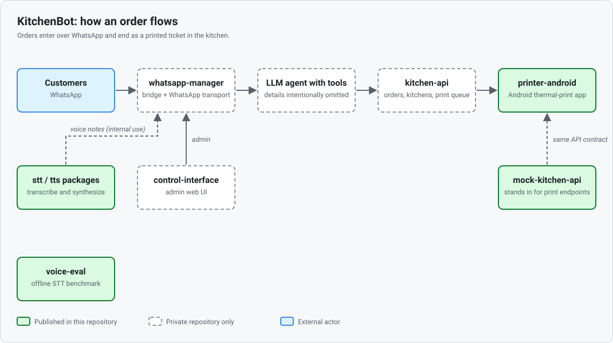

# KitchenBot Portfolio

Selected, runnable parts of KitchenBot, a WhatsApp ordering system for Mexican kitchens: a speech-recognition evaluation where the best result was 43% fully correct orders against a 65% gate, leading to a documented "defer" decision, speech packages, a thermal-printer Android app, and the architecture decisions behind them.

## The problem

Small kitchens in Mexico already receive orders over WhatsApp. KitchenBot lets customers order by text message, with an LLM ordering agent gathering the order, and prints each confirmed order as a ticket in the kitchen.

Two questions drove most of the engineering in this repository:

- Can the WhatsApp channel be made safe to depend on? The original transport is an unofficial client that can get the business number banned.
- Can customers order by voice? Spoken Mexican Spanish over noisy, compressed audio is hard, and a missing item on a kitchen order is a real cost.

## What's in this repo

| Piece | What it is | Try it |
| --- | --- | --- |
| [`voice-eval/`](voice-eval/README.md) | Evaluation harness that scores speech-to-text providers on structured orders, with deletions and substitutions reported separately. Includes the results and the go/no-go outcome. | `npm run demo -w voice-eval` |
| [`packages/stt`](packages/stt/README.md), [`packages/tts`](packages/tts/README.md) | Thin speech-to-text and text-to-speech packages: a small typed contract plus a Deepgram adapter each. | `npm test -w @kitchenbot/stt -w @kitchenbot/tts` |
| [`printer-android/`](printer-android/) | Kotlin / Jetpack Compose app that pairs with a kitchen, polls for print jobs and prints tickets on a Bluetooth thermal printer. The UI is in Spanish. Needs JDK 17 or 21. | `cd printer-android && ./gradlew test` |
| [`mock-kitchen-api/`](mock-kitchen-api/README.md) | In-memory stand-in for the kitchen backend's print endpoints, so the printer app can be paired and demonstrated without private services. | `npm start -w mock-kitchen-api` |

With Node.js 22 or newer, `npm install && npm test` at the repository root runs every Node workspace. The keyless demo needs no API key, audio or network.

## Key decisions

Each decision is written up as an architecture decision record (ADR).

- [ADR 0001: migrate the WhatsApp transport to Meta's official Cloud API.](docs/adr/0001-whatsapp-transport-migration.md) The unofficial client shows anti-abuse signals, and a ban would remove the customers' saved number, the conversation history and the order channel on the same day. The proposed decision chooses a direct integration over a reseller and puts an expiry on the rollback flag; the migration has not been completed.
- [ADR 0002: score speech recognition on structured orders, not word error rate.](docs/adr/0002-voice-poc-evaluation-criteria.md) Pass marks were fixed before any result existed: at least 65% of orders fully correct, at most 5% missing an item. Deletions and substitutions are separate metrics, because the read-back to the customer catches a wrong item but not a missing one.
- [ADR 0003: defer customer voice ordering.](docs/adr/0003-voice-channel-go-no-go.md) On 21 annotated samples from 11 speakers over telephone-grade audio, the best result (Deepgram with vocabulary boosting) had 43% of orders fully correct against the 65% gate, and 43% of orders missing an item against the 5% guardrail. No provider passed, so the channel was deferred, not dropped, because the failures are specific and addressable. A proof of concept that shows a technology is not ready is a successful one.

## Architecture

The customer order flow is text-only. See [docs/architecture.md](docs/architecture.md) for the component table, the life of an order, and which parts are published here.

## My role

I am Eduardo Arce. I built this with a small team, and I focused on the following areas.

- Designed and ran the speech-to-text evaluation in `voice-eval/`: the audio degradation pipeline, order parser, scorer and provider adapters (Deepgram, Google Cloud), the annotation guide, and the 21-sample corpus run.
- Wrote ADRs 0001 to 0003 and the research behind the WhatsApp migration and the voice go/no-go decision.
- Built the speech-to-text and text-to-speech packages and wired WhatsApp voice-note transcription and voice-note replies into the bridge.
- Contributed to the printer workflow and the Android printer app (shared work with the team), including the receipt formatter, ticket templates and editor, printer configuration, ticket header sync from the kitchen QR scan, and ESC/POS physical-status readback.

## Team

Built with a small team; teammates are credited as *the team* by their choice.

## Not included

This is a curated subset, not the whole system. Left out on purpose:

- **The conversational core.** The LLM ordering agent (not included) and the bridge around it are the product's competitive edge.
- **Production services.** The backend, admin interface, deployment and operational configuration contain proprietary logic and settings.
- **The voice corpus.** The 21 recordings are of 11 real people, so neither the audio nor the transcripts are published. `voice-eval/` explains how to reproduce the study with your own recordings.

## License

All rights reserved; published for portfolio review only. See [NOTICE](NOTICE).
