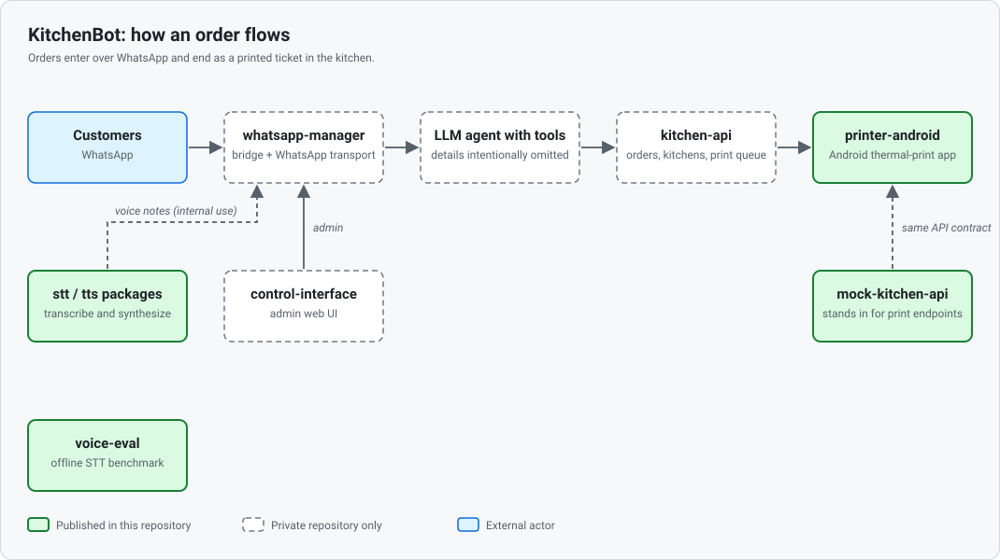

# KitchenBot architecture overview

KitchenBot lets customers order food over WhatsApp and turns each order into a
ticket printed in the kitchen. This page maps the components, marks which ones
are published in this repository, and summarises the architecture decisions
behind the parts that are.

## Components

| Component | What it does | In this repo? |
| --- | --- | --- |
| **whatsapp-manager** (bridge, including the WhatsApp transport) | Receives customer messages through the WhatsApp transport, hands each conversation to the ordering agent, sends replies back, and keeps delivery state and an audit trail. The transport is currently an unofficial linked-device client; [ADR 0001](adr/0001-whatsapp-transport-migration.md) decides to replace it with Meta's official Cloud API. | No |
| **Hermes** (LLM agent with tools) | The ordering agent that talks to customers and takes orders. *Details intentionally omitted.* | No |
| **kitchen-api** | System of record for orders, kitchens and the print queue. Printers poll it for pending print jobs and acknowledge them. | No |
| **control-interface** | Admin web UI for operating the system and inspecting its state. | No |
| **`packages/stt`, `packages/tts`** | Thin, provider-agnostic speech-to-text and text-to-speech packages behind a small contract, with a Deepgram adapter each. They support voice-note transcription and voice-note replies for internal and experimental use; customer voice ordering is deferred ([ADR 0003](adr/0003-voice-channel-go-no-go.md)). | Yes |
| **`voice-eval/`** | Disposable evaluation harness that benchmarks speech-to-text providers, scoring structured orders (deletions and substitutions reported separately). It produced the evidence for [ADR 0003](adr/0003-voice-channel-go-no-go.md). | Yes |
| **`printer-android/`** | Android app that pairs with a kitchen, polls for print jobs and prints tickets on a Bluetooth thermal printer. The UI is in Spanish. | Yes |
| **`mock-kitchen-api/`** | In-memory stand-in for kitchen-api's print endpoints, so the printer app can be paired and exercised without the private backend. | Yes |

The private components are not published because they contain the proprietary
ordering logic and operational configuration. This repository contains the
pieces that can be read, run and tested on their own.

## Life of an order

At the level of boxes:

1. A customer sends a WhatsApp text message.
2. The WhatsApp transport delivers it to the **whatsapp-manager** bridge.
3. The bridge passes the conversation to the **ordering agent**, which gathers
   the order and records it through **kitchen-api**.
4. kitchen-api queues a print job for the kitchen.
5. **printer-android** polls the print queue, prints the ticket, and
   acknowledges the job. During development, **mock-kitchen-api** plays the
   kitchen-api role for this step.
6. The bridge delivers the agent's reply to the customer over the transport.
7. Operators use **control-interface** to administer the system.

The customer order flow is text-only. Customer voice ordering is deferred per
[ADR 0003](adr/0003-voice-channel-go-no-go.md); the speech packages are used
only for internal and experimental voice-note work.

The agent's internals are deliberately not described here or anywhere in this
repository.

## Architecture decisions

| ADR | Decision | Status |
| --- | --- | --- |
| [0001](adr/0001-whatsapp-transport-migration.md) | Migrate the WhatsApp transport from an unofficial reverse-engineered client to Meta's official Cloud API, connecting directly rather than through a reseller. The dual-transport rollback flag has an explicit expiry: it is removed after 30 consecutive days in production without regression. Until then, no new features are built on the unofficial client. | Proposed |
| [0002](adr/0002-voice-poc-evaluation-criteria.md) | Evaluate speech recognition for ordering at the structured-order level instead of word error rate, with three separate criteria (gate, guardrail, discriminator) measured on 8 kHz telephony-grade audio. Deletions and substitutions are reported separately because the read-back to the customer catches only one of them. | Accepted |
| [0003](adr/0003-voice-channel-go-no-go.md) | Defer the customer voice-ordering channel: no tested provider or configuration passed both the gate and the guardrail, although vocabulary boosting improved results materially. Internal operator voice-note transcription is unaffected. The decision is to be revisited, not treated as closed. | Accepted: defer |

Raw result files, audio and the original cost analysis behind ADR 0001 are
available in the private repository.
